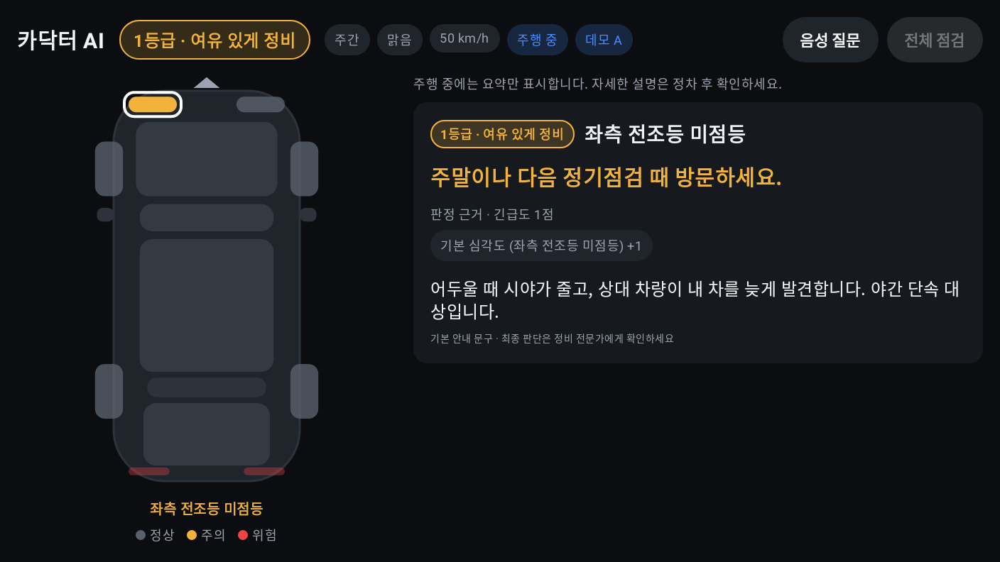
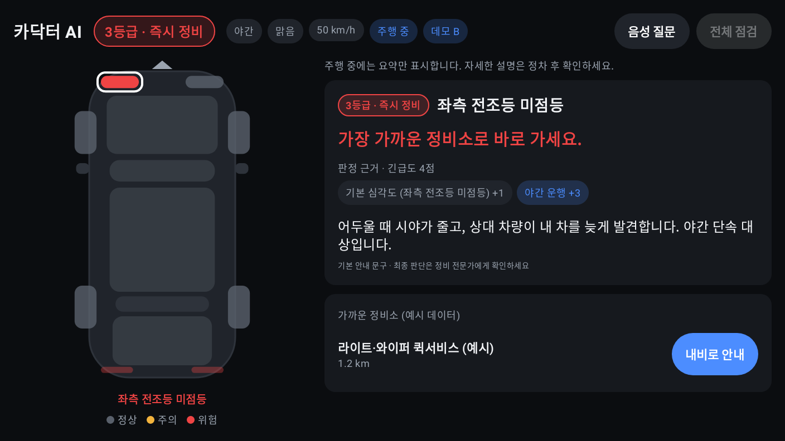
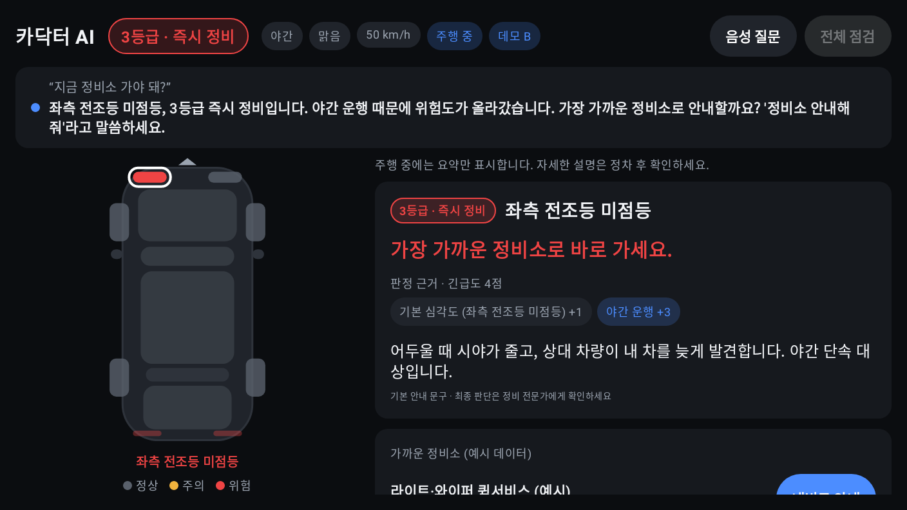
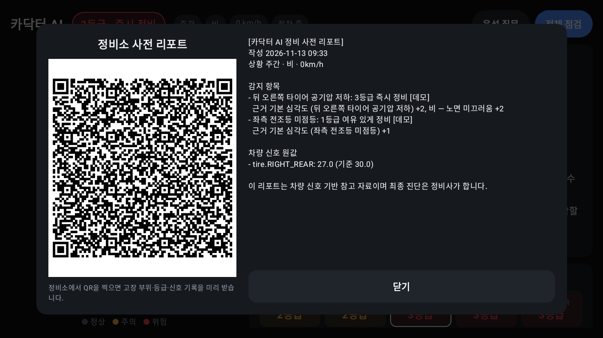

# 카닥터 AI (v1)

**차량 경고등과 주행 상황을 함께 따져 "지금 정비소에 가야 하나?"를 4단계로 알려주는 Pleos Connect 차량용 앱.**

같은 고장이라도 상황에 따라 답이 달라져요. 전조등 고장은 낮에는 "주말 방문(1등급)"이지만, 밤이 되면 "즉시 정비(3등급)"로 바뀌고 정비소를 차량 내비 목적지로 바로 보냅니다.

| 낮 · 전조등 고장 → 1등급 | 같은 고장, 밤 → 3등급 |
| --- | --- |
|  |  |
| **음성 질문 "지금 가야 돼?"** | **정비소 사전 리포트(QR)** |
|  |  |

## 실행 방법

1. Android Studio(또는 JDK 17 + Android SDK 35)를 준비합니다.
2. Pleos Connect 에뮬레이터를 설치합니다([가이드](https://document.pleos.ai/docs/connect/guide/getting-started/application-development/setup-connect-sdk-emulator)).
   - SDK Manager → SDK Update Sites에 Pleos Connect System Image를 추가하고 API 34 이미지를 설치합니다.
   - AVD 설정: Automotive → **Pleos Connect v2.1.0**, RAM 4GB, Cold boot
3. (선택) AI 설명을 켜려면 `local.properties`에 `ANTHROPIC_API_KEY=...`를 추가합니다. 키가 없으면 기본 안내 문구로 동작합니다.
4. 빌드하고 설치합니다.

   ```bash
   ./gradlew installDebug
   ```

   프로젝트 경로에 한글이 있는 Windows에서는 단위 테스트가 `ClassNotFoundException`으로 실패합니다. 이때는 빌드 폴더를 ASCII 경로로 옮겨서 실행하세요.

   ```bash
   ./gradlew -PbuildRoot=C:/build/cardoctor :app:testDebugUnitTest
   ```

5. 데모 패널은 **좌상단 "카닥터 AI" 제목을 길게 누르면** 열립니다. 여기서 할 수 있는 것은 다음과 같습니다.
   - 시나리오 A/B/C(낮·밤 전조등, 빗길 고속 타이어)와 D(서서히 빠지는 공기압 예측)를 재현합니다.
   - 마이크가 없는 에뮬레이터에서도 음성 질문 문장을 넣어 볼 수 있습니다.
6. 상단 **"음성 질문"** 버튼을 누르고 말하면 됩니다(주행 중에도 사용 가능). 지원하는 질문은 "지금 가야 돼?", "왜 위험해?", "정비소 안내해줘", "리포트 보여줘"입니다.

## 테스트 환경

| 항목 | 값 |
| --- | --- |
| 에뮬레이터 | Pleos Connect v2.1.0 (Android 14, API 34) |
| 화면 | 가로형 차량 디스플레이 (AVD 기본 해상도) |
| minSdk / targetSdk | 28 / 35 |
| 언어·UI | Kotlin 2.0, Jetpack Compose |
| Pleos SDK | Vehicle 2.3.2, NaviHelper 3.0.5, TextToSpeech 3.3.1, SpeechToText 3.3.1, FusedLocation 1.1.3 (공개 SDK 5종 모두 사용) |

## APK

- 위치: `apk/팀명_카닥터AI_release.apk` (일요일 제출 전에 팀명으로 이름을 바꿉니다)
- 빌드: `./gradlew assembleRelease` → `app/build/outputs/apk/release/app-release.apk`

## 구조

| 경로 | 역할 |
| --- | --- |
| `engine/RuleEngine.kt` | 긴급도 = 기본 심각도 + 환경 가중치 → 4등급. 순수 Kotlin이며 단위 테스트는 PRD의 판정표 그대로입니다 |
| `engine/Daylight.kt` | 좌표로 일출·일몰을 계산해 야간 여부를 판단합니다(네트워크 불필요) |
| `sdk/VehicleSource.kt` | Vehicle SDK에서 Safety 경고등(telltale), 타이어 공기압, 엔진오일·브레이크액, 워셔액, 기어를 읽습니다 |
| `sdk/TelltaleMapper.kt` | 경고등 타입(TPMS, ABS, ENGINE_TEMPERATURE 등)을 판정 대상 부품으로 매핑합니다 |
| `sdk/NaviSource.kt` | NaviHelper로 정비소를 목적지로 설정하고, 목적지까지 남은 거리를 읽습니다 |
| `sdk/Speaker.kt` | Pleos TTS로 3등급 이상 음성 경고와 음성 답변을 냅니다(실패 시 Android TTS로 대체) |
| `sdk/Listener.kt` + `engine/VoiceCommands.kt` | (확장 A2) Pleos SpeechToText로 음성 질문을 받고, 키워드 규칙으로 상태 답변·정비소 안내·설명·리포트를 처리합니다 |
| `data/EnvironmentSource.kt` | Pleos FusedLocation으로 위치를 받고(미지원 시 Android 위치), 연속 위치로 속도를 계산합니다. 날씨는 Open-Meteo(키 불필요)에서 가져옵니다 |
| `data/DemoSource.kt` | 데모 패널(고장 주입, 시간·날씨·속도 덮어쓰기, 시나리오 A/B/C/D)을 담당합니다 |
| `engine/TrendPredictor.kt` | (확장 C) 타이어 공기압 추이를 직선으로 근사해 경고 기준 도달 일수를 예측합니다(14일 이내만 표시) |
| `data/History.kt` | (확장 H) 실제 차량 신호의 감지 이력을 저장하고, 30일 중 3일 이상 나타나면 반복 고장으로 표시합니다 |
| `engine/ServiceReport.kt` | (확장 B) 고장·등급·근거·신호 원값을 한 장으로 정리합니다. 화면에서 QR로 보여줍니다 |
| `ai/Explainer.kt` | Claude가 원인·위험·할 일 3줄을 작성합니다. 등급은 바꾸지 않으며, 실패하면 템플릿 문구로 대체합니다 |
| `ui/` | 차량 상단뷰 다이어그램, 판정 카드, 긴급출동, 정비소 목록, 예측·이력 카드, 리포트 시트, 데모 패널 |

## 화면 미리보기 (에뮬레이터 없이)

`ScreenRenderTest`가 Robolectric으로 주요 화면을 렌더링해 `docs/renders/`에 PNG로 저장합니다. 장면은 시나리오 A/B/C, 정차 상세, 4등급, 정상, 점검 중, 예측·이력, 리포트, 반복 고장, 데모 패널입니다.

```bash
./gradlew -PbuildRoot=C:/build/cardoctor :app:testDebugUnitTest --tests "*ScreenRenderTest"
```

## 알려진 제약 (v1)

- 긴급출동 번호(`MainViewModel.ROADSIDE_NUMBER`)는 검증하지 않은 값입니다. 제출 전에 공식 번호로 확인해야 합니다.
- 공기압 추이 샘플은 메모리에만 있어서, 앱을 다시 켜면 예측이 처음부터 다시 쌓입니다. 데모 D는 합성 샘플을 씁니다.

- 정비소는 OpenStreetMap(Overpass API)에서 반경 5km를 검색합니다. 위치가 없거나 검색 결과가 없으면 예시 목록으로 대체하고 화면에 "예시 데이터"로 표시합니다. OSM의 국내 정비소 수록률은 지역마다 다르므로, 배포 시에는 국내 지도 API나 제휴 정비 네트워크 데이터로 보강해야 합니다.
- 전조등 "개별 전구 고장" 신호는 공개 SDK에 없어서 데모 주입으로 재현합니다. LED_HEADLAMP 경고등은 실제 신호로 받습니다.
- `ANTHROPIC_API_KEY`가 APK에 포함되는 방식은 데모용입니다. 배포 시에는 서버 프록시로 옮겨야 합니다.
